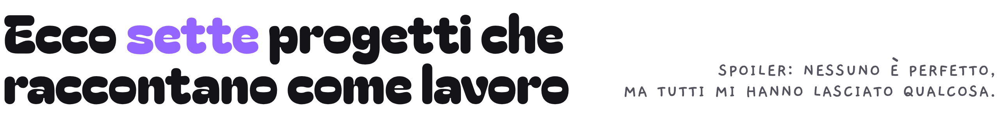
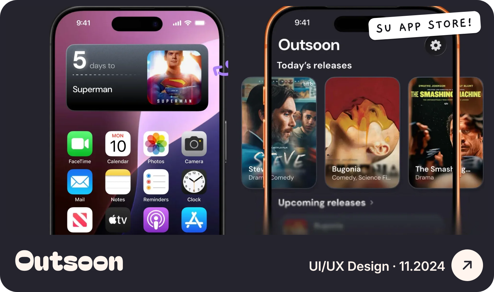
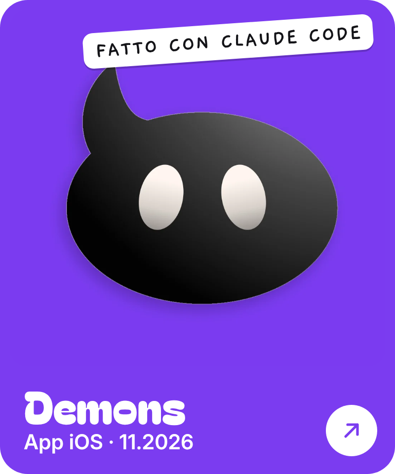
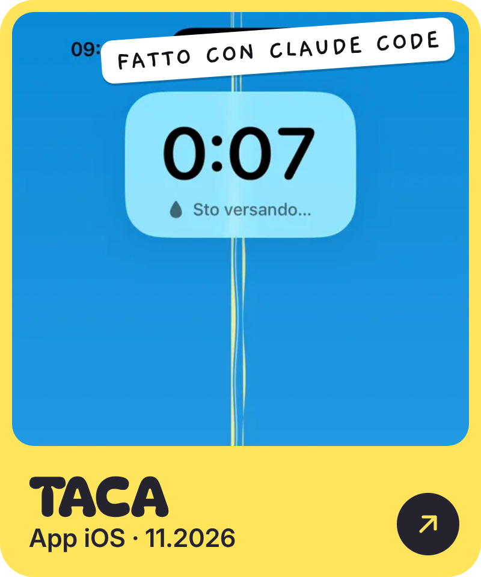
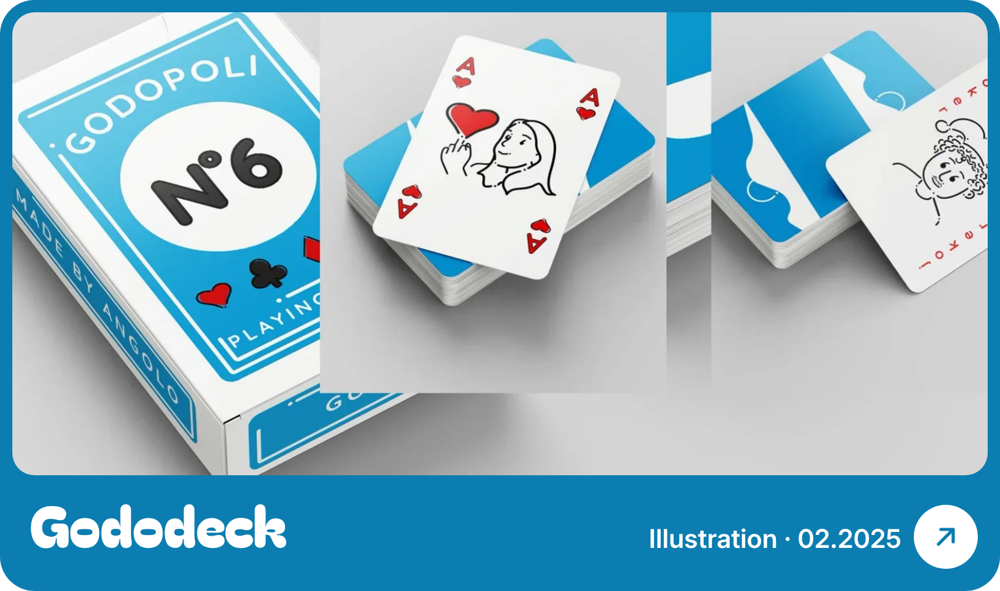
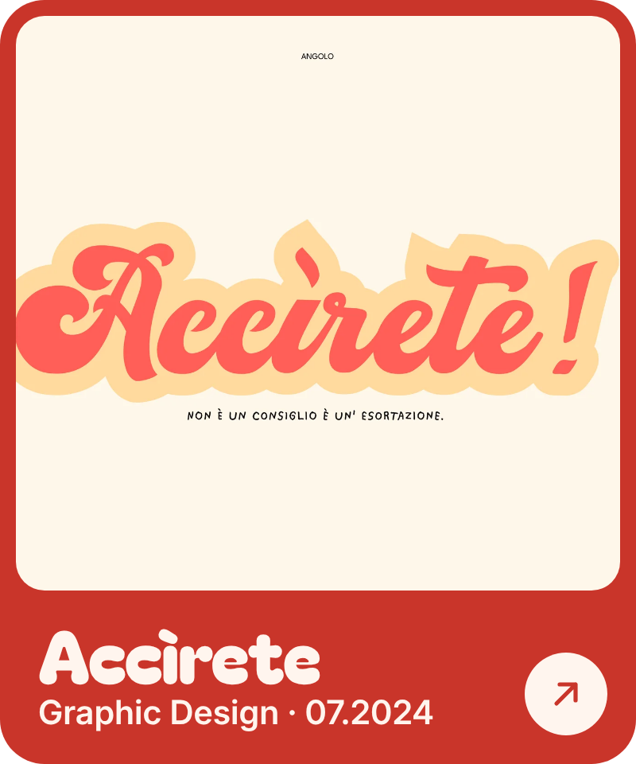
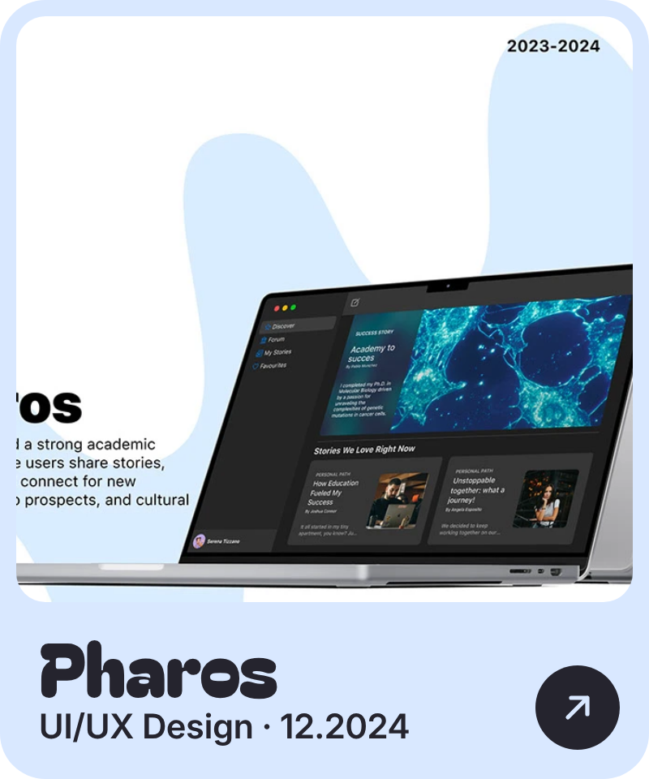
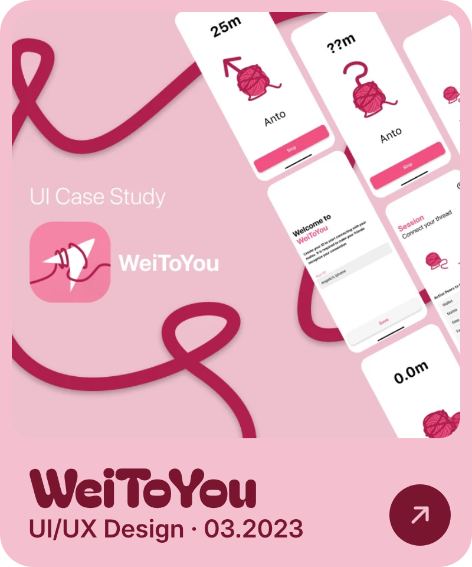
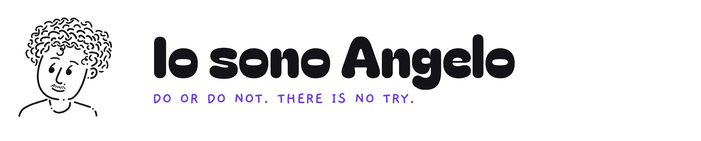
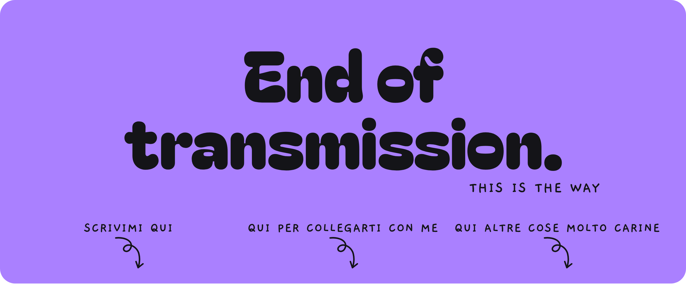

  

<picture>
  <source media="(prefers-color-scheme: dark)" srcset="assets/head-work-dark.png">
  
</picture>

  
  
  
  
  
  
  

 

<picture>
  <source media="(prefers-color-scheme: dark)" srcset="assets/head-about-dark.png">
  
</picture>

Per molti anche **Lepo** o **Angolo**, sono cresciuto tra matite e maratone di Star Wars.
Mi muovo tra UI/UX, grafica e illustrazione, cercando sempre quell’equilibrio magico tra funzionalità e sorriso:
perché se un design non ti fa dire “Uà”, allora non hai ancora finito il tuo lavoro.

Sono fermamente convinto che anche i progetti più seri abbiano bisogno di leggerezza.
Mi piace far ridere e raccontare attraverso forme e colori, senza troppe pose da “guru del design”.

| Base | Lavoro con | Faccio |
| :-- | :-- | :-- |
| Napoli | [Unicorn Donkeys](https://github.com/UnicornDonkeys) | UI/UX, grafica, illustrazione e app |

 

  <a href="mailto:lepore.angelo@outlook.com?subject=Ciao%20Angelo"><picture><source media="(prefers-color-scheme: dark)" srcset="assets/link-email-dark.png"></picture></a>
  <a href="https://www.linkedin.com/in/leposhow/"><picture><source media="(prefers-color-scheme: dark)" srcset="assets/link-linkedin-dark.png"></picture></a>
  <a href="https://www.behance.net/angelolepore"><picture><source media="(prefers-color-scheme: dark)" srcset="assets/link-behance-dark.png"></picture></a>

